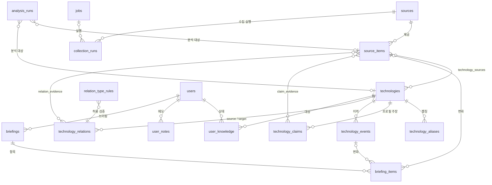

# ERD v1.1

기준: `docs/PRD.md`(v1.1), `docs/adr/0001`, `docs/adr/0002`. 정의는 `docs/ddl/v1.1.sql`이고, `docs/ddl/v1.1-checks.sql` 40개 점검을 전용 Supabase에서 40개 모두 통과했다(2026-11-05, 임시 스키마에서 실행하고 지움).

## 관계도

## 테이블과 도입 단계

| 단계 | 테이블 |
| --- | --- |
| 1 수집 | `sources`, `jobs`, `collection_runs`, `source_items` |
| 2 식별 | `technologies`, `technology_aliases`, `technology_sources`, `analysis_runs` |
| 3 지식 DB | `technology_claims`, `claim_evidence`, `technology_events`, `user_knowledge`, `user_notes`, `users` |
| 4 관계 | `technology_relations`, `relation_evidence`, `relation_type_rules`, `relation_proposals`(SPEC v1.7에서 추가) |
| 5 브리핑 | `briefings`, `briefing_items` |

스키마는 1단계 시작 때 한 번에 적용하지 않고 단계별 마이그레이션으로 나눠 적용한다. 점검 뷰 `pending_classification`, `technologies_without_source`, `relations_without_evidence`는 PRD 게이트의 "검증 쿼리"에 쓴다.

## DB가 직접 막는 것
- 중복 방지 키 3개(`source_items`의 `(source_id, external_id)`, `normalized_url`, `content_hash`)와 발췌 500자 상한(S1-06).
- 이벤트의 중복(`technology_id, event_type, occurred_at, evidence_key`)과 수정·삭제(S3-04).
- 관계의 자기 참조, 대칭 관계의 방향, 유형 조합 매트릭스(ADR-0002).
- 같은 대상의 현재 분석 2개, 실패한 분석이 현재 값이 되는 것(S2-05).
- 같은 변화를 같은 종류의 브리핑에 다시 싣는 것(S5-04).
- 모든 테이블에 정책 없이 RLS를 켜서 클라이언트 키로 읽고 쓰지 못하게 한다.

## 이번에 정한 가정 (승인 시 함께 확인)
1. `normalized_url`과 `content_hash`는 소스를 가리지 않고 전역에서 유일하다. 스파이크에서 소스 간 중복 URL이 6건 나왔기 때문이다. `content_hash`의 입력 정의는 Spec에서 정한다.
2. 발췌는 500자 이하로 DB가 강제한다.
3. 정규명은 보관되지 않은 기술 사이에서 대소문자 무시로 유일하다. 별칭은 기술 안에서만 유일해서 다른 기술과 같은 별칭을 허용하고, 모호성은 매칭 단계가 푼다.
4. 프로필은 컬럼이 아니라 필드별 주장 행이다(`technology_claims`). 한 필드에 주장이 여러 개일 수 있고, 행이 없는 필드는 "미확인"이다.
5. 유형이 `NULL`이면 분류 보류다. 관계는 유형이 정해진 기술끼리만 맺을 수 있다.
6. `event_type`과 `evidence_type`은 초안이라 enum 대신 text와 CHECK로 두었고, 값을 바꿀 때는 마이그레이션한다.
7. 근거 없는 관계와 출처 없는 기술은 저장 시점이 아니라 점검 뷰로 잡는다. 관계 저장과 근거 연결을 한 트랜잭션에서 하는 것은 구현 규칙이다.
8. `users`는 자체 테이블이고 Supabase Auth에 묶지 않는다. 웹 화면의 접근 방식(서버 경유 또는 인증)은 3단계 전에 정한다.
9. `briefing_items.kind`는 중복 방지 인덱스에 쓰려고 `briefings.kind`를 복사한 값이다.
10. 알려진 후속 변경: URL 수동 등록(S3-06)의 출처를 위해 `sources.kind`에 `manual`을 3단계 마이그레이션에서 추가한다. v1.1 DDL은 검증을 마친 상태로 두었다.
11. (2026-11-08, SPEC v1.5) 3단계 마이그레이션 0003은 DDL v1.1의 3단계 표를 그대로 옮기고, `manual` 소스 한 행과 사용자 한 행을 넣는다. 보관한 기술과 정규명이 같은 새 글은 새 기술을 만들지 않고 보관 기술에 잇는다(소문자 정규명 유일 제약은 보관 아닌 기술에만 걸리므로 DB 변경은 없다).
12. (2026-11-09, SPEC v1.7) 4단계 마이그레이션 0005는 DDL v1.1의 4단계 표에 다음을 더한다: `technology_relations.origin`(ai·manual)과 `hidden_at`, `relation_evidence.quote`(200자 이하 근거 문장), 검토 목록 `relation_proposals`. 근거 없는 관계 점검은 숨기지 않은 AI 관계에만 적용한다(직접 이은 관계는 사용자가 근거).

## 확인하지 못한 것
- 실제 부하에서의 성능과 인덱스 적합성(데이터가 없다).
- 백업과 복원(3단계 게이트에서 검증한다).
- (확인함 2026-11-08) Supabase 보안 어드바이저: `schema_migrations`의 RLS 꺼짐(ERROR)을 고쳤다. 남은 것은 "RLS는 켰지만 정책 없음"(INFO)으로, 클라이언트 키를 막으려는 의도한 상태다. 점검 뷰 2개는 `security_invoker=true`라 RLS를 우회하지 않는다. 성능 어드바이저의 외래 키 인덱스 3건과 미사용 인덱스 3건(INFO)은 데이터가 적어 지금은 그대로 둔다.
